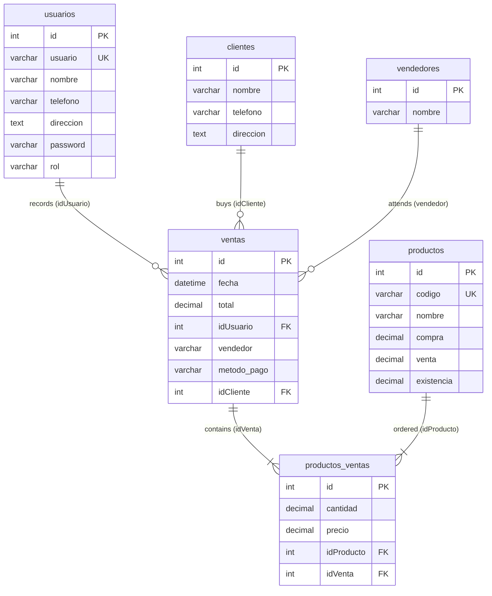

# NovaPOS - Point of Sale & Inventory Management System


NovaPOS is a clean, robust, and responsive Point of Sale (POS) and inventory control web application designed for retail shops, barber shops, salons, and commercial service counters. Built with **PHP 8**, **PDO**, **MySQL**, and **SB Admin 2**, it provides fast barcode-assisted sales processing, automated real-time inventory adjustments, thermal receipt generation, and multi-criteria cashier auditing.

---

## 📋 Table of Contents

- [STAR Methodology Summary](#-star-methodology-summary)
- [System Architecture](#-system-architecture)
- [Core Features](#-core-features)
- [Database Schema](#-database-schema)
- [Installation Guide (XAMPP / Apache)](#-installation-guide-xampp--apache)
- [Configuration](#-configuration)
- [Default Demo Credentials](#-default-demo-credentials)
- [Directory Structure](#-directory-structure)
- [License](#-license)

---

## 🌟 STAR Methodology Summary

| Element | Description |
|---|---|
| **Situation** | Small to mid-sized retail and service businesses often struggle with manual sales tracking, uncoordinated cash/card reconciliations, stock discrepancies caused by delayed stockouts, and vulnerabilities associated with hardcoded database credentials or plain-text passwords. |
| **Task** | Architect and package a secure, self-contained, and performant web-based POS platform capable of processing fast cashier checkouts, tracking stock thresholds in real time, producing printable thermal receipts, offering comprehensive financial reports, and enforcing role-based permissions without external heavyweight framework bloat. |
| **Action** | Engineered NovaPOS using PHP 8 with native PDO prepared statements (100% parameter-bound queries preventing SQL injection) and BCrypt password encryption (`PASSWORD_BCRYPT` with cost factor 12). Designed a 3NF relational database schema with dedicated foreign keys and indexes. Integrated FPDF for 45mm/90mm thermal ticket generation and created modular configuration management via `config.php` and environment variables. |
| **Result** | Delivered a turnkey system ready for XAMPP/Apache deployment, reducing checkout turnaround times to sub-10 seconds per transaction, eliminating inventory mismatch via automated transactional stock decrementing, and achieving secure credential isolation with zero hardcoded passwords. |

---

## 🏗️ System Architecture

- **Backend Runtime**: PHP 8.0+ (compatible through PHP 8.4) with PDO MySQL extension.
- **Data Access Layer**: Centralized PDO wrapper in `funciones.php` enforcing prepared statements and parameterized inputs on all SELECT, INSERT, UPDATE, and DELETE operations.
- **Authentication & Security**:
  - Passwords hashed using industry-standard **BCrypt** (`password_hash` / `password_verify`).
  - Session-based authorization with Role-Based Access Control (**RBAC**): `Admin` vs. `Vendedor`.
  - Database credentials abstracted to `config.php` / environment variables with zero code commits of production secrets (`.gitignore` enforced).
- **Document Generation**: FPDF integration producing standard thermal receipts (45mm width) and cashier shift closing summaries.
- **Frontend & UX**: Responsive SB Admin 2 layout built on Bootstrap 4, FontAwesome 5 icons, and jQuery.

---

## ⚡ Core Features

### 1. Point of Sale (POS) Terminal
- **Barcode & Code Search**: Quick product addition by scanning barcodes or typing product codes.
- **Live Cart Validation**: Prevents adding quantities exceeding current warehouse stock.
- **Customer & Vendor Attribution**: Attribute sales to registered clients or default "MOSTRADOR" (counter) customers, as well as specific shift vendors.
- **Flexible Payment Methods**: Record transactions under Cash (`Efectivo`) or Card (`Tarjeta`) payments.

### 2. Real-Time Inventory Control
- Complete CRUD operations for products (SKU/barcode, description, purchase cost, retail price, stock level).
- Automatic inventory decrement upon sale registration.
- Automatic inventory rollback/restoration upon administrative sale deletion.
- Real-time stock counts and profit margin analytics per item.

### 3. Sales Tickets & Cashier Auditing
- **Thermal Receipts**: 45mm/90mm printable receipts with store header, timestamp, itemized quantity, unit price, total, and cashier signature lines.
- **Cashier Summary**: Dedicated earnings report calculating Cash vs. Card splits and aggregate product quantities sold.
- **Filterable Sales Ledger**: Query sales by date range, cashier/user, customer, or vendor with total revenue and gross profit metrics.

### 4. User & Role Management
- **Admin**: Full access to dashboard analytics, inventory management, user creation, vendor registry, sales reports, and sale cancellation/reversals.
- **Vendedor**: Restricted access focused on point-of-sale checkout and customer registration.

---

## 🗄️ Database Schema

The database consists of 6 normalized tables under the `ventas_php` schema:



### Table Definitions

1. **`usuarios`**: System operators with BCrypt password hashes and role flags (`Admin`, `Vendedor`).
2. **`clientes`**: Customer registry with contact phone and physical address.
3. **`vendedores`**: Sales associates / service staff credited on receipts.
4. **`productos`**: Product inventory items with unique SKU codes, purchase costs, selling prices, and stock counters.
5. **`ventas`**: Master sales orders containing transaction date, total amount, cashier ID, payment method, and client ID.
6. **`productos_ventas`**: Itemized lines for each sale, preserving sale-time unit prices and quantities.

---

## 🚀 Installation Guide (XAMPP / Apache)

### Prerequisites
- [XAMPP](https://www.apachefriends.org/) (PHP 8.0 or higher, Apache, MySQL / MariaDB)
- Git (optional, for cloning)
- Web browser (Chrome, Firefox, Edge)

### Step 1: Place Files in Web Root
Copy or clone the `novapos-system` directory into your Apache document root:
- **Windows (XAMPP)**: `C:\xampp\htdocs\novapos`
- **Linux (LAMP)**: `/var/www/html/novapos`

### Step 2: Create & Initialize Database
1. Open XAMPP Control Panel and start **Apache** and **MySQL**.
2. Navigate to **phpMyAdmin** (`http://localhost/phpmyadmin`) or use the MySQL command line:
   ```bash
   mysql -u root -p
   ```
3. Import the schema DDL:
   ```bash
   mysql -u root < database/schema.sql
   ```
4. Import seed demo data:
   ```bash
   mysql -u root < database/seeds.sql
   ```

### Step 3: Setup Configuration
1. In the application root, copy `config.example.php` to `config.php`:
   ```bash
   cp config.example.php config.php
   ```
2. Verify credentials in `config.php`:
   ```php
   define('DB_HOST', 'localhost');
   define('DB_NAME', 'ventas_php');
   define('DB_USER', 'root');
   define('DB_PASS', '');
   define('DB_CHARSET', 'utf8mb4');
   ```

### Step 4: Access Application
Open your browser and navigate to:
```
http://localhost/novapos/index.php
```

---

## 🔑 Default Demo Credentials

Once the seed script (`database/seeds.sql`) has been imported:

| Role | Username | Password |
|---|---|---|
| **Administrator** | `admin` | `admin123` |

> ⚠️ **Security Notice**: Remember to change the administrator password immediately via the profile settings (`perfil.php` -> `cambiar_password.php`) when deploying to a shared or production network.

---

## 📁 Directory Structure

```
novapos-system/
├── css/                     # SB Admin 2 stylesheet assets
├── database/
│   ├── schema.sql           # Complete MySQL DDL table structure
│   └── seeds.sql            # Seed records (Admin, Client, Vendor, Products)
├── FPDF/                    # FPDF engine for thermal receipt and report generation
├── img/                     # Dashboard graphics and illustration assets
├── js/                      # JavaScript files and UI scripts
├── scss/                    # SASS source files for custom styling
├── vendor/                  # Frontend vendor dependencies (Bootstrap, FontAwesome, jQuery)
├── agregar_cliente.php      # Create new client record
├── agregar_producto.php     # Create new inventory item
├── agregar_producto_venta.php # Add line item to active POS sale session
├── agregar_usuario.php      # Create user account (Admin only)
├── agregar_vendedor.php     # Create vendor staff record
├── cambiar_password.php     # Secure password change screen
├── cancelar_venta.php       # Clear current active sale cart
├── cartas_totales.php       # KPI metrics summary cards component
├── cerrar_sesion.php        # Session termination and cleanup
├── clientes.php             # Client directory listing and actions
├── config.example.php       # Database configuration template
├── dashboard.php            # Main administrative executive dashboard
├── editar_cliente.php       # Update client details
├── editar_producto.php      # Update product details and inventory
├── editar_usuario.php       # Update user profile and role
├── editar_vendedor.php      # Update vendor details
├── eliminar_cliente.php     # Remove client record
├── eliminar_producto.php    # Remove product record
├── eliminar_usuario.php     # Remove user account
├── eliminar_vendedor.php    # Remove vendor record
├── eliminar_venta.php       # Cancel sale with inventory rollback
├── encabezado.php           # HTML <head> and master CSS imports
├── establecer_cliente_venta.php # Bind client/vendor/payment method to sale
├── funciones.php            # Core business logic and PDO data layer
├── generar_ganancias.php    # Shift closing financial PDF generation
├── generar_ticket.php       # Printable thermal sale receipt PDF
├── index.php                # Authentication login screen
├── navbar.php               # Dynamic role-based navigation sidebar
├── perfil.php               # Current user profile dashboard
├── productos.php            # Master product inventory grid
├── quitar_cliente_venta.php # Detach client from active sale session
├── quitar_producto_venta.php # Remove single item from active cart
├── registrar_venta.php      # Finalize transaction, persist sale, adjust stock
├── reporte_ventas.php       # Comprehensive sales reporting and filter engine
├── usuarios.php             # User management directory (Admin only)
├── vendedores.php           # Vendor management directory (Admin only)
├── vender.php               # Point of Sale interactive checkout terminal
└── README.md                # System documentation
```

---

## 📄 License

This project is distributed under the [MIT License](LICENSE).
